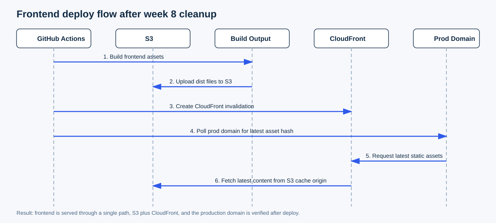
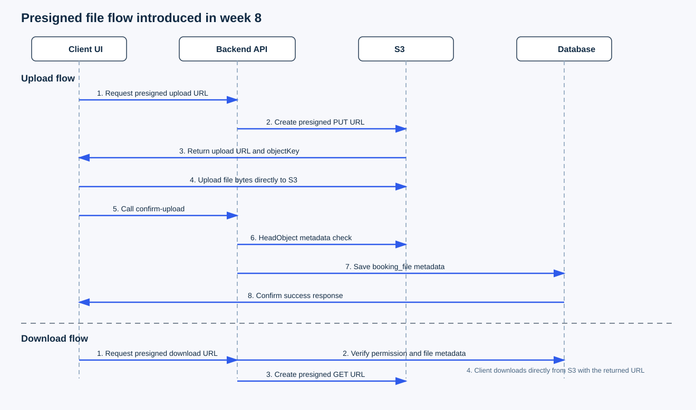

# [8주차] 이번 주는 좀 쉬었다. 대신 지난주에 만든 기반을 실제 운영 흐름으로 연결했다

_짤 출처: [Pablo Escobar Waiting | Know Your Meme](https://knowyourmeme.com/memes/pablo-escobar-waiting)_

이번 주는 솔직히 지난주만큼 빡세게 달린 주는 아니었다.

7주차에 DB 옮기고, 배포 구조 바꾸고, 시크릿/권한/서버 이슈까지 한 번에 몰아서 처리하다 보니
이번 주는 약간 숨 고르면서 정리하는 주간에 가까웠다.

그래서 이번 회고는
"이번 주도 대형 사고가 있었다"
보다는
"지난주에 만든 기반을 실제 운영 흐름에 맞게 정리했다"
에 더 가깝다.

그래도 바뀐 건 분명히 있었다.

- 프론트 배포 경로를 진짜 `S3 + CloudFront` 기준으로 정리했다
- 예약 파일 업로드/다운로드를 `Pre-signed URL` 기반으로 전환했다
- Google Calendar ID 제약을 다시 확인하고, 내가 괜히 막고 있던 부분을 고쳤다

한 줄로 요약하면 이렇다.

7주차가 "인프라 대공사"였다면,
8주차는 "그 공사를 실제 운영 동선으로 연결한 주"였다.

## 7주차 대비 이번 주에 뭐가 달라졌나

7주차에는 주로 기반을 안 터지게 만드는 일에 시간을 많이 썼다.

- SQLite -> PostgreSQL 마이그레이션
- Secrets Manager / IAM / Docker IMDS 이슈 해결
- 서버 배포 구조 재정리
- 운영 안정화와 기술 선택 기준 정리

반면 이번 주는 그 위에서
"지금 구조가 실제로도 이 방식으로 굴러가고 있는가?"
를 확인하면서, 남아 있던 우회 경로와 어색한 플로우를 걷어내는 작업을 했다.

즉, 이번 주는 많이 벌인 주는 아니었지만
내가 실제로 한 일은 더 구체적이었다.

_짤 출처: [This Is Fine | Know Your Meme](https://knowyourmeme.com/memes/this-is-fine)_

## 1. 프론트 배포 경로를 진짜 `S3 + CloudFront` 기준으로 고정했다

### 왜 이렇게 했나

이미 프론트 배포 방향은 `S3 + CloudFront`로 잡아둔 상태였다.
그런데 운영 흔적을 보면 여전히

- EC2 프론트 컨테이너
- Dockerfile
- prod compose의 frontend 서비스

같은 잔재가 남아 있었다.

이 상태가 애매한 이유는 명확했다.

- 배포는 성공했는데 사용자가 보는 경로는 예전 경로일 수 있고
- 운영 경로가 두 개처럼 보이면서 나중에 다시 헷갈릴 수 있고
- "지금 실제 서비스가 어디서 서빙되는지" 설명하기 어려워진다

결국 이미 `S3 + CloudFront`가 진짜 운영 경로라면,
EC2 프론트 컨테이너는 안전장치가 아니라 혼동 요소에 더 가까웠다.

### 내가 실제로 한 일

이번 주에는 프론트 배포 쪽에서 아래를 정리했다.

1. GitHub Actions 배포 워크플로우를 수정했다.
2. `CLOUDFRONT_DISTRIBUTION_ID`를 써서 CloudFront invalidation을 수행하게 했다.
3. `PROD_DOMAIN` 기준으로 실제 프로덕션 도메인이 최신 asset을 서빙하는지 폴링 검증 단계를 넣었다.
4. 더 이상 쓰지 않는 `frontend/Dockerfile`을 제거했다.
5. `docker-compose.prod.yml`에서 프론트 서비스도 제거했다.

즉, "배포 스크립트만 바꾼 것"이 아니라
"실제 운영 경로를 하나로 정리한 것"에 더 가까웠다.

아래는 이번 주에 정리한 프론트 배포 흐름이다.

_이번 주에 정리한 프론트 배포 흐름_

### 확인한 것

- CloudFront URL 접속 확인
- `www.cohi-chat.com`에서 최신 해시 자산이 반영되는지 확인
- `/api/*`는 CloudFront behavior를 통해 ALB로 전달되는지 확인

### 이번 작업에서 느낀 점

이번에 다시 느낀 건,
"배포 성공"과 "사용자 성공"은 다르다는 점이었다.

CI가 초록불이어도
실제 사용자가 보는 도메인이 예전 파일을 보고 있으면
그건 그냥 실패다.

그래서 이번 작업의 핵심은 invalidation 자체보다,
"실제 운영 경로를 하나로 설명 가능하게 만드는 것"에 있었다.

_짤 출처: [Daily Struggle / Two Buttons | Know Your Meme](https://knowyourmeme.com/memes/daily-struggle-two-buttons)_

## 2. 예약 파일 업로드/다운로드를 `Pre-signed URL` 플로우로 바꿨다

이번 주에 내가 가장 자세히 손댄 건 이 부분이었다.

### 왜 이렇게 했나

기존 파일 업로드 흐름은 대체로 이런 식이었다.

- `FE -> BE -> S3`

이 방식은 구현은 단순하지만,
파일 바이트가 전부 백엔드를 통과해야 한다.

그러면 자연스럽게 문제가 생긴다.

- 서버 부하가 커진다
- 업로드 홉이 하나 더 생긴다
- 파일이 커질수록 비효율이 커진다
- 나중에 파일 트래픽이 늘어나면 스케일 비용도 커진다

그래서 이번에는
파일 자체는 클라이언트가 S3에 직접 올리고,
백엔드는 권한 확인과 검증에 집중하는 구조로 바꿨다.

### 바뀐 전체 흐름

아래는 이번 주에 바꾼 파일 업로드/다운로드 시퀀스다.

_이번 주에 바꾼 예약 파일 업로드/다운로드 흐름_

핵심 플로우는 이렇게 바뀌었다.

- `FE -> BE (presigned upload URL 발급 요청)`
- `FE -> S3 (직접 PUT 업로드)`
- `FE -> BE (confirm-upload)`
- `BE -> S3 metadata 검증`
- `BE -> DB 저장`

다운로드도 비슷하게

- `FE -> BE (presigned download URL 요청)`
- `BE -> 권한 검증`
- `FE -> S3 (직접 다운로드)`

로 바꿨다.

### 백엔드에서 내가 한 일

이번 작업에서 백엔드 쪽은 생각보다 손댈 게 많았다.

1. Presigned URL 관련 API를 추가했다.

- `POST /bookings/{bookingId}/files/presigned-upload-url`
- `POST /bookings/{bookingId}/files/confirm-upload`
- `GET /bookings/{bookingId}/files/{fileId}/presigned-download-url`

2. `S3PresignedUrlService`를 추가해서
업로드/다운로드용 presigned URL 생성과 S3 메타데이터 조회를 담당하게 했다.

3. `ConfirmUploadRequestDTO`를 추가해서
클라이언트가 업로드 완료 후 어떤 정보를 들고 confirm할지 명시적으로 분리했다.

4. presigned URL 발급 단계에서 사전 검증을 넣었다.

- 파일명 검증
- 확장자 검증
- Content-Type 검증

5. Locale 이슈를 피하기 위해 확장자 처리를 `Locale.ROOT` 기준으로 바꿨다.

이건 별거 아닌 것 같지만,
서버 Locale에 따라 대소문자 변환이 달라질 수 있어서
식별자나 확장자 처리에서는 고정 Locale이 더 안전하다.

6. `Content-Type`은 raw 문자열 비교 대신 파싱/정규화로 바꿨다.

예를 들면 아래 같은 경우가 있다.

- `text/plain`
- `Text/Plain`
- `text/plain; charset=UTF-8`

의미는 거의 같은데 문자열 그대로 비교하면 실패할 수 있다.
그래서 `MediaType.parseMediaType()`으로 파싱한 뒤
`type/subtype` 기준으로 정규화해서 비교하도록 바꿨다.

7. 가장 중요하게는 `confirm-upload` 단계에서 S3 실제 메타데이터를 검증하도록 했다.

클라이언트가 보내는

- `objectKey`
- `fileSize`
- `contentType`

를 그대로 믿으면 우회 가능성이 생긴다.

그래서 confirm 단계에서 아래를 확인하게 했다.

1. 이 `objectKey`가 실제로 서버가 발급한 presigned 요청인지
2. S3 `HeadObject`로 본 실제 `contentLength`, `contentType`이 무엇인지
3. 요청값과 실제 S3 메타데이터가 일치하는지
4. 검증 실패 시 DB 저장을 막고 정리할 게 있는지

즉, 이번 작업의 핵심은
"S3로 바로 보내서 빠르게 하자"가 아니라
"파일 바이트는 직접 보내되, 신뢰는 서버가 다시 검증하자"에 있었다.

8. confirm 실패 시 orphan object를 best-effort로 정리하도록 했다.

presigned PUT는 성공했는데 confirm 단계에서 막히면
S3에 파일만 남을 수 있어서,
실패 경로에서는 삭제 시도까지 하도록 넣었다.

### 프론트엔드에서 내가 한 일

프론트도 단순히 API 한두 개 붙인 수준은 아니었다.

1. presigned URL 요청용 API 함수들을 추가했다.

- `getPresignedUploadUrl`
- `confirmUpload`
- `getPresignedDownloadUrl`

2. 업로드 훅/호출 흐름을 바꿨다.

기존에는 `FormData`를 백엔드로 보내는 흐름이었다면,
이제는

- presigned upload URL 요청
- S3 직접 PUT
- confirm-upload 호출

순서로 바뀌었다.

3. 다운로드도 presigned URL 기반으로 바꿨다.

4. 파일 삭제 API와 `useDeleteBookingFile` 훅을 추가했다.

5. 삭제 UX도 바꿨다.

기존에는 하나 삭제 중이면 전체 파일 항목이 다 같이 막히는 느낌이었다면,
이번에는 `deletingFileId`를 추적해서
현재 삭제 중인 파일만 로딩/비활성화되도록 바꿨다.

이건 사소해 보여도 사용자 입장에서는 꽤 중요하다.
지금 어떤 파일이 처리 중인지 명확하게 보이기 때문이다.

6. 업로드 실패 시 화면에 에러 메시지가 보이도록 했다.

즉, "백엔드 구조 바꿈"이 끝이 아니라
실제 사용자가 만지는 업로드/다운로드/삭제 경험도 같이 다듬었다.

### 내가 실제로 검증한 것

이번 작업은 구현만 하고 끝내지 않고 아래를 확인했다.

- Backend 테스트 통과
- Frontend lint / test 통과
- 실제 S3 업로드 확인
- `booking_file` 테이블에 `objectKey`가 정상 저장되는지 확인
- 허용되지 않은 파일 업로드 시 에러 메시지가 잘 뜨는지 확인
- 다운로드와 삭제 흐름이 실제 화면에서 동작하는지 확인

### 이번 작업에서 느낀 점

이번 작업은 단순한 성능 최적화 작업이 아니었다.

진짜 핵심은
"파일은 직접 보내되, 신뢰 경계는 서버가 다시 잡는다"
는 구조를 만든 데 있었다.

즉, 경로는 더 가벼워졌고,
검증은 더 강해졌다.

_짤 출처: [Hard to Swallow Pills | Know Your Meme](https://knowyourmeme.com/memes/hard-to-swallow-pills)_

## 3. Google Calendar ID 제약도 다시 확인해서 고쳤다

이건 규모는 작지만 꽤 중요한 수정이었다.

### 왜 이렇게 했나

기존에는 Google Calendar ID를
`@group.calendar.google.com`
형식만 허용하고 있었다.

처음에는 그게 맞는 줄 알았다.
근데 다시 확인해보니까
Google Calendar API의 `calendarId`는 훨씬 일반적인 식별자였다.

- 개인 캘린더는 이메일 형식일 수도 있고
- 현재 로그인한 사용자의 기본 캘린더는 `primary` 키워드로도 접근할 수 있고
- 결국 "group calendar만 허용"은 API 정책이라기보다 내가 세운 제한에 가까웠다

### 내가 실제로 한 일

이번에는 그 가정을 걷어냈다.

1. Backend에서 `CalendarCreateRequestDTO`, `CalendarUpdateRequestDTO` 정규식을 수정했다.
2. Frontend의 `RegisterStep2.tsx`에서도 입력 검증과 placeholder를 같이 수정했다.
3. 관련 테스트를 보강했다.

코드 양은 많지 않았지만,
제품 관점에서는 의미가 분명했다.

원래 되는 걸 내가 막고 있었던 부분을 풀어낸 거니까.

### 이번 작업에서 느낀 점

이 이슈를 보면서 다시 느낀 건,
제품 정책은 "왠지 이럴 것 같다"로 결정하면 안 된다는 점이었다.

특히 외부 플랫폼 규칙은
공식 문서를 다시 확인하고,
내가 걸어둔 제한이 진짜 정책인지 먼저 봐야 한다.

_짤 출처: [Boardroom Suggestion | Know Your Meme](https://knowyourmeme.com/memes/boardroom-suggestion)_

## 4. 그래서 이번 주는 "많이 한 주"보다 "덜 이상하게 만든 주"였다

이번 주는 분명 지난주보다 덜 빡셌다.
이건 사실이다.

근데 그렇다고 빈 주는 아니었다.

이번 주에 한 일들을 다시 보면,
다 화려한 신기능이라기보다

- 운영 경로를 하나로 맞추고
- 파일 플로우를 더 가볍고 안전하게 만들고
- 제품 제약을 실제 정책에 맞게 고친

작업들이었다.

이런 주가 왜 중요하냐면,
프로젝트는 매주 폭발적인 기능 추가만으로 굴러가지 않기 때문이다.

오히려 이미 만든 걸

- 덜 헷갈리게 만들고
- 덜 우회 가능하게 만들고
- 덜 잘못 가정하게 만드는

주간이 쌓여야 다음 작업도 안정적으로 붙는다.

개인적으로 8주차는
"많이 한 주"라기보다
"지난주에 만든 기반을 실제 서비스 구조로 정리한 주"
라고 부르는 게 더 맞는 것 같다.

_짤 출처: [Roll Safe | Know Your Meme](https://knowyourmeme.com/memes/roll-safe)_

## 참고한 공식 문서

- [Amazon CloudFront Developer Guide - Invalidation](https://docs.aws.amazon.com/AmazonCloudFront/latest/DeveloperGuide/Invalidation.html)
- [Amazon S3 User Guide - Download and upload objects with presigned URLs](https://docs.aws.amazon.com/AmazonS3/latest/userguide/using-presigned-url.html)
- [Google Calendar API Reference](https://developers.google.com/workspace/calendar/api/v3/reference)
- [Google Calendar API - Calendars: patch](https://developers.google.com/workspace/calendar/api/v3/reference/calendars/patch)
- [Google Calendar API - CalendarList: get](https://developers.google.com/calendar/api/v3/reference/calendarList/get)
- [MDN - `<a>`: The Anchor element / `download`](https://developer.mozilla.org/en-US/docs/Web/HTML/Element/a#download)
